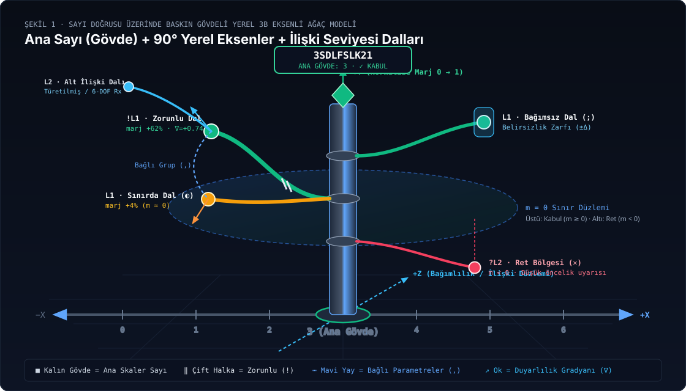
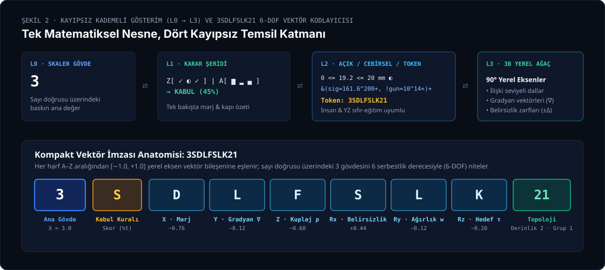

# 3D Numbers

**Sayı doğrusu üzerinde yerel 3B eksenli ağaç görselleştirmesi, çok kriterli bağlamsal sayı notasyonu ve 6 serbestlik dereceli (6-DOF) gradyan-vektör prototipi.**

`3D Numbers`, bir skaler sayıyı yalnızca yalın bir büyüklük olarak değil; sınırları, normalize marjı, belirsizlik zarfı, duyarlılık gradyanı ($\nabla$), öncelik sınıfı ve parametre bağımlılıklarıyla birlikte tek bir matematiksel nesne olarak ele alan **ölçeklenebilir bir notasyon ve 3B görselleştirme çerçevesidir**.

---

## Grafiksel Mimari: Sayı Doğrusu Üzerinde Açan 3B Ağaç

Sayı doğrusu ($X$ ekseni) üzerinde oturan sabit sayı, **ağacın en baskın gövdesi (ana göstergeç)** olarak konumlanır. Bu noktadan $90^\circ$ dik yükselen yerel $Y$ (normalize marj $0 \rightarrow 1$) ve $Z$ (bağımlılık/ilişki düzlemi) eksenleri üzerinde her dal, bir kriterin veya serbestlik derecesinin **ilişki seviyesini (L1 / L2)**, **zorunluluk durumunu** ve **gradyan vektörünü** taşır:



### Görsel Eşleme Kuralları

| Görsel Öğe | Matematiksel Karşılık | Okuma Kuralı |
| :--- | :--- | :--- |
| **Kalın Merkezi Gövde** | Sayı doğrusundaki baskın ana sayı ($x_0$) | Sayı doğrusunda tam konumuna oturur; taç ışığı genel hükmü (`✓`, `±`, `✕`) gösterir. |
| **Çift Halka (`‖`)** | Zorunlu kapı kriteri (`!`) | Geçilmez şart; tek bir zorunlu dalın `m < 0` bölgesine düşmesi tüm tasarımı reddeder. |
| **Dal Seviyesi (`L1`, `L2`)** | İlişki derinliği | `L1` doğrudan gövdeden $90^\circ$ çıkar; `L2` alt dallar bağlı oldukları `L1` düğümünden dallanır. |
| **Mavi Kavisli Köprü** | Bağlı parametre grubu (`,`) | Aynı fiziksel/istatistiksel kaynaktan türeyen (kuple) kriterleri birbirine bağlar; `;` ile ayrılan bağımsız dallar farklı eksen sektöründe durur. |
| **$m = 0$ Eşik Düzlemi** | Normalize kabul sınırı | Düzlemin üstü kabul (`m ≥ 0`), yüzeye yapışık amber bölge sınır uyarısı (`◐`, `m < 0.12`), altı ret bölgesidir (`m < 0`). |
| **Gradyan Oku ($\nabla$)** | Duyarlılık vektörü ($\partial m / \partial x$) | Dal ucundan çıkan okun yönü ve boyu, tasarım değişkenindeki kaymanın marjı ne kadar hızlı değiştirdiğini gösterir. |
| **Yarı Saydam Silindir** | Belirsizlik zarfı ($\pm\Delta$) | İstatistiksel güven aralıklarını (ör. %95 CI) deterministik dallarla aynı uzayda taşır. |

---

## Kayıpsız Kademeli Gösterim (L0 → L3) ve `3SDLFSLK21` Kodlayıcısı

Aynı matematiksel nesne bilgi kaybı olmaksızın dört seviye arasında çift yönlü dönüştürülebilir:



### 1. Kompakt Vektör İmzası (`3SDLFSLK21`)

Tek bir skaler sayının arkasına eklenen deterministik harf-rakam dizisi, o sayının **6 serbestlik dereceli (6-DOF)** yerel vektör alanını ve ağaç topolojisini satır içinde kodlar:

```text
3  S  D  L  F  S  L  K  21
│  │  └──┴──┴──┴──┴──┴── 6-DOF yerel eksenler (A..Z → [-1.0, +1.0])
│  │       X: Konum Marjı · Y: Gradyan ∇ · Z: Kuplaj ρ
│  │       Rx: Belirsizlik ±Δ · Ry: Ağırlık w · Rz: Hedef Sapması τ
│  └── Kabul Kuralı (A=& Hepsi, S=% Skor, K=k/n, O=/ Veya)
└───── Sayı doğrusundaki baskın gövde sayısı (x₀ = 3)
       Sondaki "21" → Dal derinliği (2) ve bağlı grup sayısı (1)
```

Uygulamadaki **Notasyon** laboratuvarında `3SDLFSLK21` metnini doğrudan düzenleyebilir veya 6-DOF sürgülerini hareket ettirerek hem imzanın hem de 3B ağacın gerçek zamanlı değişimini test edebilirsiniz.

---

### 2. İki Katmanlı Notasyon: Sıfır-Eğitim Okunabilirlik + Uzman Kısaltması

Kuralları hiç görmemiş bir insanın veya dil modelinin (LLM) ilk bakışta doğru yorumlayabilmesi için sistem **iki eşdeğer metin katmanı** üretir:

#### Katman A — Açık Biçim (Sıfır-Eğitim İnsan & YZ Okunabilir)
```text
ağırlıklı skor >= 0.25 (ana=300 mm):
  zorunlu sig     0 <= 161.6 <= 200 MPa          ✓  (marj +19%)
  zorunlu del     0 <= 19.2 <= 20 mm             ◐  (marj +4%)
  zorunlu h       200 <= 300 <= 340 mm           ✓  (marj +44%)
          tl      12660 <= 16000 TL              ✓  (marj +84%)
  zorunlu gun     0 <= 10 <= 14 gün              ✓  (marj +44%)
sonuç: KABUL (UYARILI)
```

#### Katman B — Kısa Cebirsel Biçim (Resmî BNF Dilbilgisi)
```ebnf
ifade  := [tip] "(" grup { ";" grup } ")" [hüküm] [ "{" yorum "}" ]
grup   := öge { "," öge }
öge    := eleman | ifade
eleman := [ "!" | "?" ] ad "=" değer [ "^" üst ] [ "_" alt ] [ "@" ideal ] işaret [ "*" ağırlık ]
tip    := "&" | "/" | k "/" n | "%" eşik
işaret := "+" | "-"
hüküm  := "+" | "-" | "+-"
```

Örnek ifadeler:
- **IPE 300 (Hepsi kabul, teslim bağımsız):** `&(sig=161.6^200_0@0+, del=19.2^20_0@0+, h=300^340_200@250+, tl=12660^16000@12000+; !gun=10^14_0+)+`
- **En az 3/4 esnek + zorunlu teslim:** `3/4(sig=210^200_0-, del=27.8^20_0-, h=270^340_200+, tl=10830^16000+; !gun=10^14_0+)-`
- **Kullanıcı takdiri ve zorunlu denetim gerekçesi:** `&(sig=198^200_0+, del=20.1^20_0-, h=300^340_200+)+-{0.1 mm aşım, baş mühendis onayı bekliyor}`

> **İzlenebilirlik Kuralı:** Yazarın verdiği hüküm (`+`, `-`, `+-`) matematiksel kural sonucuyla çelişiyorsa, sistem `{yorum}` gerekçesini zorunlu kılar; başarısız bir tasarım sessizce kabul edilemez.

---

## Normalize Marj Formülü

Her kriter, birimi ne olursa olsun ortak $0 \rightarrow 1$ eksenine taşınır:

- **Düşük iyidir** (ör. gerilme, sehim, maliyet):
  $$m = \frac{\text{sınır}_{\text{üst}} - x}{\text{sınır}_{\text{üst}} - x_{\text{ideal}}}$$
- **Yüksek iyidir** (ör. getiri, güvenlik katsayısı, istatistiksel güç):
  $$m = \frac{x - \text{sınır}_{\text{alt}}}{x_{\text{ideal}} - \text{sınır}_{\text{alt}}}$$
- **Çift yönlü hedef tolerans (`◆`)** (ör. çap $D = 20.04 \in [19.90, 20.10]$):
  $$m = 1 - \frac{|x - x_{\text{hedef}}|}{\min(\text{üst} - x_{\text{hedef}},\; x_{\text{hedef}} - \text{alt})}$$

---

## Alan Örnekleri (Aynı Çekirdek Kural Setiyle)

| Alan | Ana Gövde ($x_0$) | Sınanan Özellik |
| :--- | :--- | :--- |
| **6-DOF Vektör Sayısı** | `3` (`3SDLFSLK21`) | Sayı doğrusu üstünde 6 eksenli gradyan-vektör kodlaması |
| **Mühendislik (Ana Vaka)** | `h = 300 mm` (IPE 300) | Eurocode S355 çelik kiriş ($\sigma, \delta, h, \text{TL}, \text{gün}$), zorunlu kapılar ve ağırlık duyarlılık dönüm noktası |
| **Finans** | `Getiri = %14.8` | Volatilite, maksimum düşüş (MDD), Sharpe oranı ve bağımsız likidite koşulu |
| **İstatistik** | `Cohen d = 0.62` | %95 güven aralığı belirsizlik zarfları ($\pm\Delta$), p-değeri ve istatistiksel güç |

---

## Kurulum ve Çalıştırma

```bash
# Bağımlılıkları yükle
npm install

# Geliştirme sunucusunu başlat (http://localhost:3000)
npm run dev

# Üretim derlemesi oluştur
npm run build
```

## Proje Yapısı

```text
├── docs/
│   ├── tree-number-line.svg        # 3B sayı doğrusu & baskın gövdeli ağaç şeması
│   └── notation-architecture.svg   # Kayıpsız L0–L3 ve 3SDLFSLK21 token anatomisi
├── src/
│   ├── engine/
│   │   ├── types.ts                # AST, 6-DOF ve değerlendirme veri modelleri
│   │   ├── parser.ts               # BNF ayrıştırıcı, 3SDLFSLK21 codec ve L0–L3 dönüştürücü
│   │   └── presets.ts              # Eurocode S355 kiriş fiziği, finans ve istatistik örnekleri
│   ├── components/
│   │   ├── TreeViewport3D.tsx      # Three.js etkileşimli 3B sayı doğrusu ve yerel eksenli ağaç
│   │   ├── NormalizedRulerView.tsx # L1 karar şeridi ve 0–1 normalize marj cetveli
│   │   ├── NotationLabView.tsx     # Canlı ayrıştırıcı, 3SDLFSLK21 stüdyosu ve iki katmanlı çıktı
│   │   └── SensitivityCompareView.tsx # IPE 270–360 karşılaştırma ve ağırlık dönüm noktası grafiği
│   └── App.tsx                     # Ana çalışma alanı ve kayıpsız görünüm yönlendiricisi
└── README.md
```
